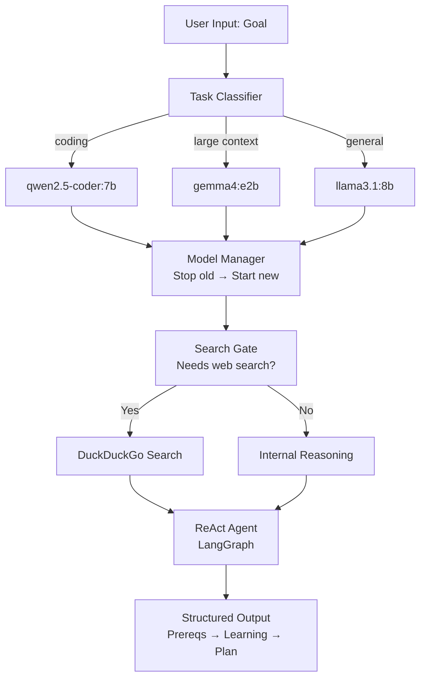

# Local AI Planning Agent — Implementation Plan

## Overview

Build a full-featured **Local AI Planning Agent** in Python that:
- Understands a user's goal via a reasoning loop
- Dynamically selects between 3 local Ollama models based on task type
- Uses DuckDuckGo web search only when needed
- Produces a strict structured output (Prerequisites → Learning Path → Step-by-step Plan)

The current `main.py` is a working MVP — this plan upgrades it into the full spec-compliant system.

---

## Current State Analysis

| File | Status | Notes |
|------|--------|-------|
| `main.py` | ⚠️ Partial | Basic ReAct agent, single model, no model switching, no system prompt per spec |
| `.env` | ⚠️ Empty | `BRAVE_API_KEY` is set but empty — DuckDuckGo needs no key |
| `log.txt` | 📝 Log | Contains output from a previous run (startup query) |
| `venv/` | ✅ Ready | Python virtual environment exists |
| `readme.md` | ✅ Complete | Full spec defined |

---

## User Review Required

> [!IMPORTANT]
> The spec defines 3 local models via Ollama: `llama3.1:8b`, `qwen2.5-coder:7b`, and `gemma4:e2b`. Please confirm all three are installed and available via `ollama list`. If any are missing, we can skip dynamic switching for those.

> [!WARNING]
> The spec says **only one model runs at a time** and the current model must be stopped before switching. We'll implement this by calling `ollama stop <model>` via subprocess before loading a new one. This requires Ollama CLI to be accessible in PATH.

> [!NOTE]
> `BRAVE_API_KEY` in `.env` appears to be intentionally empty. The current code uses DuckDuckGo (no key needed). We'll keep DuckDuckGo as the default and leave the `.env` for future Brave Search integration.

---

## Proposed Changes

### Core Agent Logic

#### [MODIFY] [main.py](file:///d:/scripting/Planner_Agent/main.py)

Complete rewrite with the following features:
- **Task Classifier**: Detects whether the goal is coding/technical or general planning
- **Model Switcher**: Selects and loads the correct Ollama model, stopping the previous one
- **System Prompt**: Enforces the strict output format from the spec
- **Reasoning Loop**: `Understand → Analyze → Decide → Act → Refine → Answer`
- **Search Gate**: Only triggers DuckDuckGo if the task needs external knowledge
- **Structured Output**: Ensures response always contains `Prerequisites`, `Learning Path`, `Step-by-step Plan`

---

### New Files

#### [NEW] `agent/classifier.py`
- `classify_task(goal: str) -> str` — returns `"coding"`, `"large_context"`, or `"general"`
- Uses keyword matching + optional LLM call on `llama3.1:8b`

#### [NEW] `agent/model_manager.py`
- `ModelManager` class
- `switch_to(model_name: str)` — stops the current model via `ollama stop`, starts new one
- `get_llm() -> ChatOllama` — returns the active LLM instance

#### [NEW] `agent/planner.py`
- `run_planner(goal: str)` — full reasoning loop
- Calls classifier → model manager → builds ReAct agent → decides search → streams output

#### [NEW] `agent/search_gate.py`
- `needs_search(goal: str, model) -> bool` — LLM-based decision
- Prevents unnecessary tool calls for well-known topics

#### [NEW] `agent/__init__.py`
- Package init

#### [NEW] `requirements.txt`
- Pins all dependencies: `langchain-ollama`, `langchain-community`, `langgraph`, `python-dotenv`

---

## Architecture Diagram



---

## File Structure After Implementation

```
Planner_Agent/
├── main.py                  # Entry point (rewritten)
├── agent/
│   ├── __init__.py
│   ├── classifier.py        # Task type detection
│   ├── model_manager.py     # Ollama model switching
│   ├── planner.py           # Full reasoning loop
│   └── search_gate.py       # Search decision logic
├── requirements.txt         # NEW
├── .env                     # BRAVE_API_KEY (optional future use)
├── log.txt                  # Existing log
├── readme.md                # Spec (unchanged)
└── venv/                    # Existing virtualenv
```

---

## Open Questions

> [!IMPORTANT]
> 1. **Model availability**: Are all 3 models (`llama3.1:8b`, `qwen2.5-coder:7b`, `gemma4:e2b`) installed in Ollama? Run `ollama list` to check.
> 2. **Interactive vs. batch mode**: Should the agent loop (ask for another goal after finishing), or run once and exit?
> 3. **Logging**: Should the agent log every run to `log.txt` automatically, or only on demand?

---

## Verification Plan

### Automated Tests
```powershell
# Activate venv and run
cd d:\scripting\Planner_Agent
.\venv\Scripts\Activate.ps1
python main.py
```

Test with these sample inputs:
1. `"I want to build a SaaS product"` — general → `llama3.1:8b`, no search
2. `"How to write a REST API in FastAPI"` — coding → `qwen2.5-coder:7b`
3. `"What are the latest AI models in 2026"` — needs search → DuckDuckGo triggered

### Manual Verification
- Confirm output always has `Prerequisites:`, `Learning Path:`, and `Step-by-step Plan:`
- Confirm only one Ollama model is running at a time (check via `ollama ps`)
